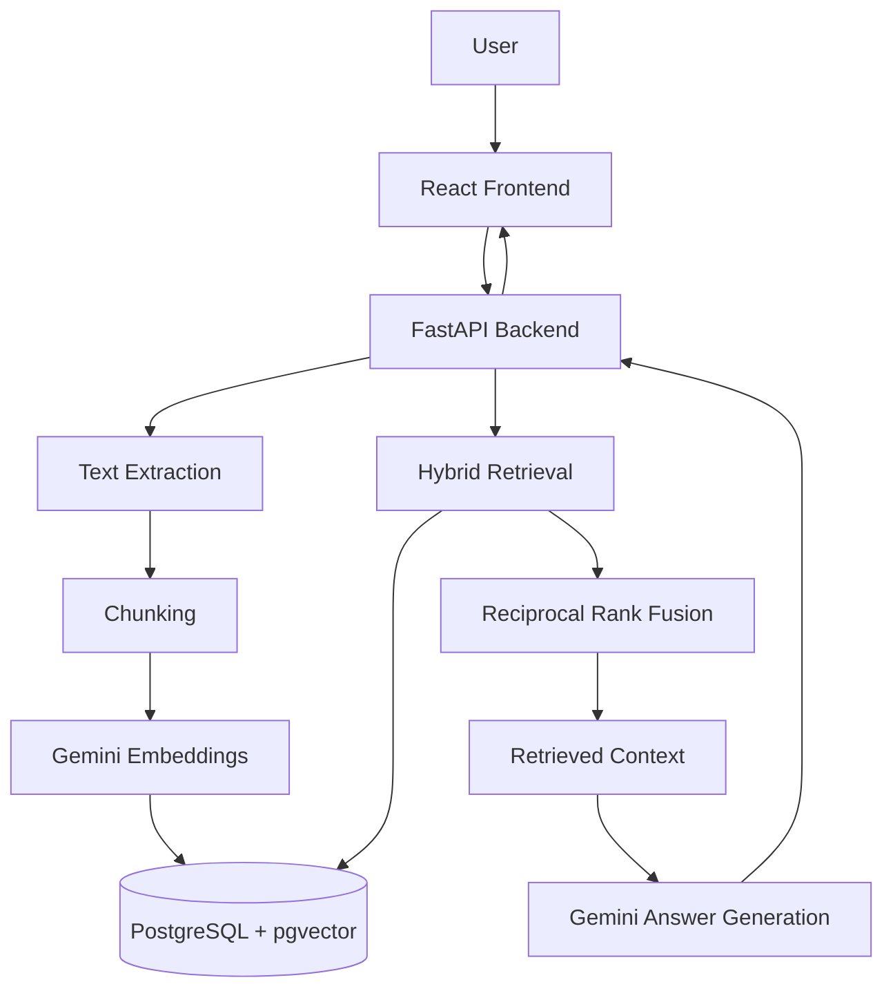

# Second Brain OS 🧠

**An AI-powered personal knowledge management system using Retrieval-Augmented Generation (RAG).**

Second Brain OS lets users upload documents, index their content, and ask natural-language questions. It retrieves relevant document chunks and uses Google Gemini to generate answers grounded in the available knowledge base.

**Live Demo:** https://second-brain-os-six.vercel.app  
**Backend API:** https://second-brain-os-69sy.onrender.com  
**Health Check:** https://second-brain-os-69sy.onrender.com/health

## ✨ Features

- **Document ingestion:** Upload PDF, TXT, and Markdown files.
- **Text processing:** Extract document text and split it into overlapping chunks.
- **Semantic embeddings:** Generate vector embeddings using Google's Gemini embedding model.
- **Hybrid retrieval:** Combine vector similarity search and PostgreSQL full-text search.
- **Reciprocal Rank Fusion:** Combine ranked retrieval results into a unified candidate list.
- **Grounded answers:** Generate answers using retrieved document context.
- **Source attribution:** Display supporting document sources alongside answers.
- **Failure handling:** Validate uploads and handle indexing, database, and AI-service failures.
- **Automated testing:** Test API behavior, indexing, uploads, and error-handling paths.

## 🏗️ Architecture



## 🧰 Tech Stack

**Frontend**
- React
- TypeScript
- Vite

**Backend**
- Python
- FastAPI
- PyMuPDF
- Pydantic

**AI and Retrieval**
- Google Gemini API
- Text embeddings
- PostgreSQL full-text search
- pgvector
- Reciprocal Rank Fusion (RRF)
- Retrieval-Augmented Generation (RAG)

**Database and Infrastructure**
- PostgreSQL
- psycopg connection pooling
- Render — backend deployment
- Vercel — frontend deployment

**Testing**
- pytest
- FastAPI TestClient
- Mock-based API and indexing tests
- Retrieval evaluation scripts

## 🔄 How It Works

1. A user uploads a supported document.
2. The backend extracts its text and splits it into overlapping chunks.
3. Gemini generates embeddings for the chunks.
4. The chunks and embeddings are stored in PostgreSQL.
5. When the user asks a question, the backend retrieves candidates using vector and keyword search.
6. Reciprocal Rank Fusion combines the retrieval rankings.
7. Relevant context is passed to Gemini to generate a grounded answer.
8. The frontend displays the answer and supporting document sources.

## 🚀 Run Locally

### Prerequisites

- Node.js and npm
- Python
- PostgreSQL configured with the required pgvector extension
- Google Gemini API credentials

### 1. Clone the repository

```bash
git clone https://github.com/surajprajapati-12/second-brain-os.git
cd second-brain-os
```

### 2. Configure the backend

```bash
cd backend
python -m venv .venv
```

Activate the environment on Windows PowerShell:

```powershell
.venv\Scripts\Activate.ps1
```

Install backend dependencies:

```bash
pip install -r requirements.txt
```

Create a local `backend/.env` file using `backend/.env.example` as a reference, if available. Configure the required PostgreSQL connection settings and Gemini API credentials. Never commit real credentials.

### 3. Start the backend

Follow the repository's backend startup configuration. The API should expose its health endpoint at:

`http://127.0.0.1:8000/health`

Interactive API documentation is available at:

`http://127.0.0.1:8000/docs`

### 4. Start the frontend

Open another terminal:

```bash
cd frontend
npm install
```

Configure the frontend API URL according to the project's environment-variable setup, then run:

```bash
npm run dev
```

Open the local Vite URL shown in the terminal.

## 🧪 Testing

Run the backend test suite from the repository root:

```bash
python -m pytest backend/tests -q
```

The current verified result is **39 passed**. Three dependency deprecation warnings were present during that run.

The repository also contains retrieval evaluation scripts and a baseline report under `backend/evaluation-results/`. Review the evaluation methodology and results before publishing numerical performance claims.

## 🔐 Security and Reliability

- Keep API credentials in environment variables.
- Do not commit `.env` files containing secrets.
- Validate file types and enforce upload-size limits.
- Use parameterized database queries.
- Handle database and AI-provider failures without exposing internal error details to API clients.
- Use the PostgreSQL connection pool to reuse database connections.

## 📌 Future Improvements

- Add authentication and per-user document isolation.
- Improve document deletion and re-indexing workflows.
- Add background indexing jobs for larger documents.
- Expand retrieval evaluation across more query types.
- Add latency and retrieval-quality monitoring.
- Improve automated deployment and integration checks.

## 👨‍💻 Author

**Suraj Prajapati**

Built as a full-stack AI knowledge management project exploring RAG, vector search, hybrid retrieval, backend reliability, and production deployment.
